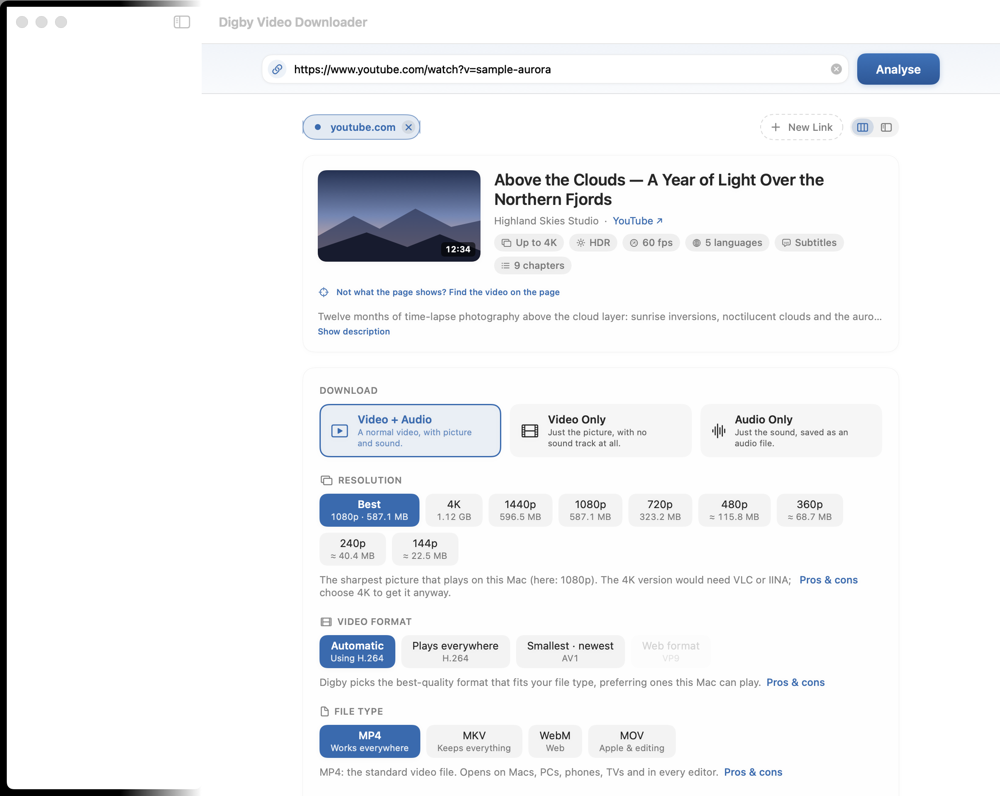

# Digby Video Downloader

*Anything you find. Yours to keep.*

A native macOS app for downloading video and audio from thousands of websites. Paste a link, see exactly what you'll
get in plain English, and download it at the quality you chose, or be told clearly why not.

Part of the Digby family, with [Digby Video Compressor](https://github.com/drwojakmd/digby-video-compressor).



## Install

Digby Video Downloader is free and open source (MIT); the source code is in this repository.
Get the latest version from the **[Releases page](https://github.com/drwojakmd/digby-video-downloader/releases)**
(about 5 MB). See also the [website](https://drwojakmd.github.io/downloader/).

Open the disk image from the release and drag **Digby Video Downloader** to **Applications**. On first launch Digby
sets up its download engines (about 150 MB, a minute or so). It does this once, by itself.

Requirements: a Mac with Apple Silicon (M1 or later) running macOS 14 Sonoma or later. You don't need Homebrew,
Python, Xcode or the command line.

## Using it

1. **Paste a link** (or drop it on the window, or press **⌃⌥⌘D** anywhere to download the link you just copied).
   Several links at once become a batch. Playlists and channels open as a list you can tick.
2. Digby **reads the page** and shows a preview: title, length, and which resolutions, formats, languages and
   subtitles the site really offers. Nothing is downloaded yet.
3. **Choose**, in plain English. Every choice explains itself, with pros and cons:
   - **Download**: Video + Audio, Video Only, or Audio Only.
   - **Resolution**: only the ones this video has, each with its file size.
   - **Video format**: Automatic, or Plays everywhere (H.264) / Smaller · Apple (HEVC) / Smallest · newest (AV1) / Web (VP9).
   - **File type**: MP4, MKV, WebM or MOV.
   - **Sound language** (original or dubbed), **audio file** (As it is, M4A, MP3, FLAC, WAV, Opus) and **subtitles**
     (inside the video or as separate files; written by a person or automatic).
   - **See Every Format** shows the full technical list for advanced users.
4. **You'll get** says exactly what arrives, for example *1080p 60 · H.264 · AAC · English (original) · MP4 · 288 MB ·
   no conversion*. If something can't be done exactly (say, 4K in a MOV file), Digby says so and offers alternatives.
   It never quietly gives you something lower or re-encodes the picture.
5. **Paste more while you wait.** Every link opens as its own tab above the page; earlier ones keep going.
6. **Download.** Every finished file is checked (right picture, sound, format and length) before it's called done.
   **Compress with Digby** then hands it to Digby Video Compressor if you want it smaller, and **Details** shows the
   original (everything the site offered), what you chose, and what was checked, any time later from History.

## When a site won't cooperate

Some sites block download programs, or hide their video in ways no engine understands yet. If you can watch it,
Digby can usually still get it: choose **Find the Video on the Page** (or ⇧⌘F). The page opens in Digby's own
browser; sign in or pass any check as you normally would, press play, and Digby catches the stream the player loads,
then shows the usual choices.

## Signed-in videos and VPNs

YouTube checks for robots more strictly on VPNs. When it asks, Digby offers to use your sign-in: either your
browser's (read fresh for each download and never stored) or a sign-in window inside Digby. Sign-ins are sent only
to that site. Manage them in Settings → Privacy.

## Engines that keep themselves up to date

Digby uses [yt-dlp](https://github.com/yt-dlp/yt-dlp) to understand websites, [FFmpeg](https://ffmpeg.org) to put
files together and check them, and [Deno](https://deno.com) for sites that need JavaScript. It downloads them from
their publishers and installs one only after checking it's genuine (signed checksums or the publisher's Apple
Developer ID) and test-running it. Updates install between downloads. When a site changes and downloads break,
Digby fetches a newer engine by itself and tries again. Every update can be rolled back in Settings → Engines.

## Privacy

Links, files and sign-ins never leave your Mac except to the site you're downloading from. Digby contacts GitHub and
the FFmpeg build server only to check for engine updates. Diagnostic reports remove links, cookies and your user name.

## Building from source

Command Line Tools are enough (no Xcode needed):

```bash
Scripts/build_app.sh          # → build/Digby Video Downloader.app (runs the unit tests first)
Scripts/build_app.sh --dmg    # also builds the disk image
swift run digby-dl-tests     # unit tests (use --scratch-path outside iCloud-synced folders)
```

`digby-dl` is a command-line front end to the same engine (`digby-dl analyse <link>`, `digby-dl download <link> --res 1080`).
Design, architecture and test notes are in [Docs/](Docs).

## Known limitations

- **Not notarised** yet (that needs a paid Apple Developer ID), so macOS asks for confirmation the first time you open it. The release notes explain the one-time step.
- **DRM-protected media, paywalls and access controls are not bypassed.** Download only what you have the right to keep.
- **Sites change.** Digby updates its engine automatically, but a brand-new site change can take a few days to be fixed upstream.
- **Sites behind Cloudflare** (Rumble, sometimes Vimeo) may refuse the engine on VPNs; use Find the Video on the Page.

## Licence and third-party software

MIT © 2026 Digby. The download engines have their own licences (yt-dlp: Unlicense, with GPLv3+ components in its
macOS build; FFmpeg: GPLv3+; Deno: MIT). Digby downloads them from their publishers; see
[Docs/THIRD_PARTY_NOTICES.md](Docs/THIRD_PARTY_NOTICES.md).
